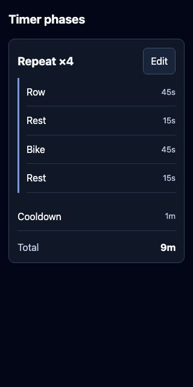
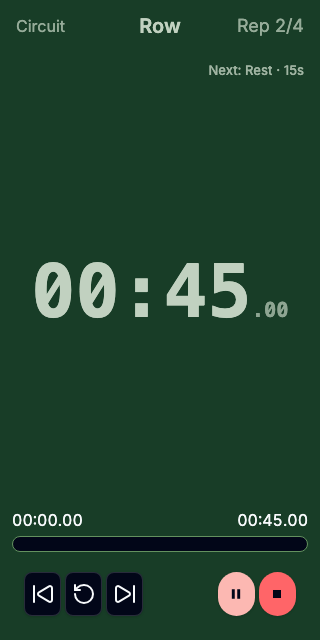
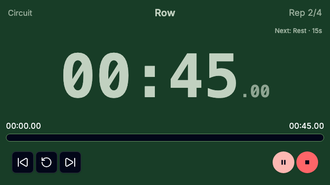

# Repeat phase groups

**Status** — Approved and implemented.

## Configure

In Timer phases, choose **Repeat**, select the first and last consecutive phase, enter the total number of passes, and tap **Apply**. Number the picker options so two phases named Rest are distinguishable. A single phase can repeat too. The example group takes two minutes per pass. Four passes plus one minute of cooldown finish at 9:00.

Show the group once with a **Repeat ×4** heading. **Edit** changes the range or count. **Ungroup** keeps one copy of its phases. Cancel discards pending group edits. Keep the existing individual phase controls available in the editor. Support separate, non-overlapping groups. Prevent overlapping and nested ranges. Apply a proposed limit of 100 passes per group and 1,000 executed phases per timer; explain an exceeded limit next to Apply.

[Try the group editor](repeat-phases/preview.html). Tap Repeat in the ungrouped list to select a range and count. After applying, Edit reopens the selection. Ungrouping is specified for implementation.

## Run and preview

Inside a group, use the existing phase-counter position for **Rep 2/4**. Keep the full phase position available to screen readers. Outside groups, show the usual phase count. Keep the centered phase title, reserved status line, Up Next and playback controls. Preserve the header's original footprint when the shorter label fits on one line. An Interval's own round count stays in its usual place.

In Timeline Preview, collapse each group by default. Expand to inspect passes and their start times, then inspect the phases of a pass. Apply existing rules for manual waits, pre-start time, open phases and skipped final rests.

## Ordering and recovery

Store stable group and member identities with a repeat count. Persist each phase definition once. Treat legacy timers as ungrouped. Use one traversal for duration, timeline, Up Next, playback, navigation and recovery. Track a child's phase ID and the current pass so revisiting a phase initializes a fresh timer. Next and Previous cross repeat boundaries one phase at a time. Restart from first phase restarts the entire timer; child Restart retains its existing scope. After the last pass, continue to the following phase exactly once.

## Acceptance

- Sample group starts at 0:00, 2:00, 4:00 and 6:00. Cooldown begins at 8:00. Changing four passes to three updates Finish to 7:00.
- Verify crossing boundaries in both directions, restarting, automatic and manual advancement, background catch-up and reload on pass three. Check a repeated Tabata with its own interval rounds.
- Check create/edit/ungroup by touch and keyboard, invalid ranges, storage validation and distinct saved IDs for different repeat structures.
- Screenshots above are design previews. On the running screen a temporary label was placed over the current app. The measured digit box and footer matched their original geometry at 320 × 640 and 667 × 375.

## Implemented screens

[Choose phases](repeat-phases/implemented-editor.png) · [Grouped editor](repeat-phases/implemented-setup.png) · [Timeline](repeat-phases/implemented-timeline.png) · [Running in portrait](repeat-phases/implemented-run-portrait.png) · [Running in landscape](repeat-phases/implemented-run-landscape.png)

The mobile checks covered editing, cancelling, ungrouping, saving and reopening a preset, navigation across passes, a delayed return from the background, and recovery of an Interval on pass three. The repeat indicator occupied the same layout space as the existing phase counter in both tested orientations.
