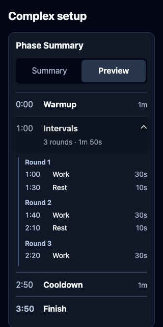
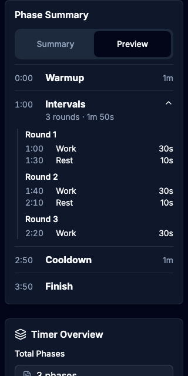
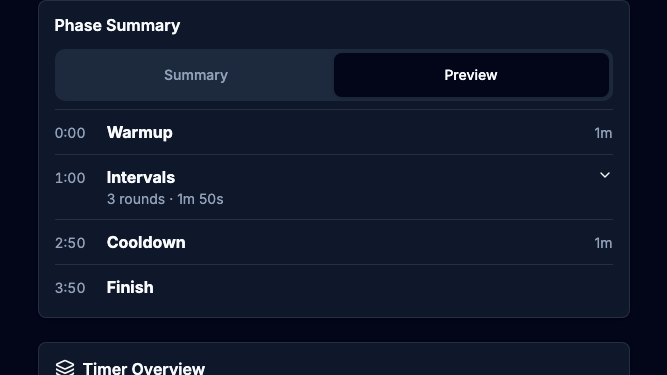

# Complex setup timeline preview

**Status** — Approved and implemented.

In Complex setup, open **Preview** inside Phase Summary to answer “When does each phase start?” Summary remains the default. Preview uses the current draft and opens without saving, starting the timer or playing cues. All new information lives in setup so the running clock retains its full display area.

[Try the phone mockup](timeline-preview/preview.html). Switch views or tap Intervals to expand and collapse its rounds. The mockup uses one example timer.

## Reading the timeline

The left column shows elapsed start times. The right shows durations. Start with one row per phase and a Finish row. Tapping an Interval row reveals the work and rest steps grouped by round. Omit zero-length rests and skipped final rests. Keep long lists collapsed initially and reveal long blocks in batches. Allow long phase names to wrap and keep timestamps aligned with their first line.

For the illustrated timer, including the last rest moves Cooldown from 2:50 to 3:00 and Finish from 3:50 to 4:00. A configured pre-start countdown gets a separate Get ready row before its phase, and offsets include that countdown once.

An open Stopwatch, self-paced Work/Rest, or manual transition makes later start times uncertain. Keep the phase sequence and each known duration visible. Replace uncertain timestamps with a dash and label the first uncertain boundary (for example, “Tap Next to continue”). Show a configured cap as a limit. Only show an exact finish time when the entire sequence is timed and automatic.

## Acceptance checks after approval

Verify included and skipped final rests, zero-rest EMOM, hour-long durations, pre-start countdowns, manual transitions and open phases. Edits should update the timeline from the draft. Check touch and keyboard expansion, accessible expanded state and 320 px layout with long names.

## Implementation checks

Mobile Chromium verified touch and keyboard expansion, both final-rest settings, manual advancement, long names and updates after editing a draft. Unit tests cover pre-start precedence, phase order, hour-long phases, zero-rest intervals, capped and open Stopwatches, and self-paced Work/Rest.

