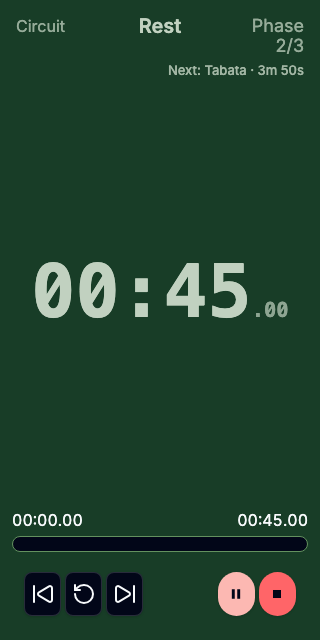
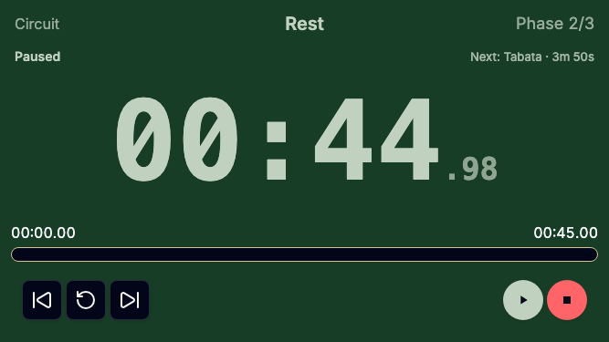

# Up Next for Complex timers

**Status:** Approved, implemented and verified in mobile Chromium emulation.

A person resting between phases should be able to glance at the phone, read the remaining time first, then see which phase to prepare for. In this example, the current phase is Rest and the next is an eight-round Tabata with its final rest skipped.

## Proposed layout

Use the status line already reserved under the Complex timer header. Keep the phase title centered above the digits. Place the upcoming phase at the trailing edge in smaller, secondary text. When present, Paused, Get ready, Complete or the waiting status takes the leading side of the line. Use the existing status layout when there is no next phase. Keep the hint outside the live status announcement so ticks do not cause repeated announcements.

## Information priority

1. Give the digits and timer controls their existing space in both orientations. The hint gets one line and cannot wrap or add a row. If a state has no reserved status row, show the hint only where it can fit without enlarging the header.
2. Give status text priority. Drop the optional duration first, then truncate the phase name. Omit the hint if too little room remains for a meaningful name. Expose the full next name to assistive technology.
3. Show the next phase in the configured order. Display a duration only when the total is known. Respect skipped final rests. Omit the duration on self-paced phases. After the final phase, omit the hint entirely.
4. The hint describes what comes next whether advancement is manual or automatic. Skip, Previous, Restart and restored progress must resolve against the actual phase index.

## Preview evidence and implementation checks

These images came from the current app with a temporary browser-only layout overlay. Compared with the same timer before adding the overlay, the digit box and footer top had identical measured positions and dimensions. The digit font measured 73.19 px in portrait and 120.84 px in landscape. This comparison covers the two illustrated states.

Before marking the feature done, repeat the comparison in the implemented app with long names, a two-line current title, an overall time limit, and the denser Interval and Work/Rest headers. Exercise pause/resume, manual wait, the last phase, skips, and reload. Verify at 320 px in portrait and on a short landscape screen, including the light theme. If the hint competes with the clock in any state, shorten or omit the hint.

## Implemented screens

The digit box and footer matched the layout with the hint removed at both sizes. The digit font measured 73.19 px at 320 × 640 and 120.84 px at 667 × 375. Browser tests also exercise a long name, an overall limit, manual completion, navigation, pause, resume and reload in the light theme.

