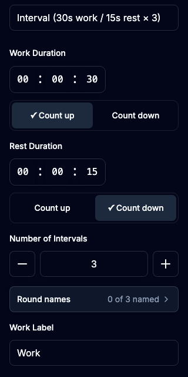
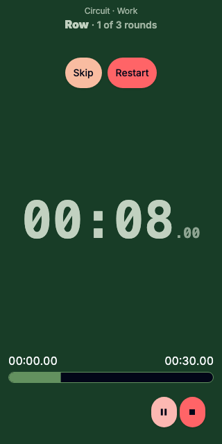
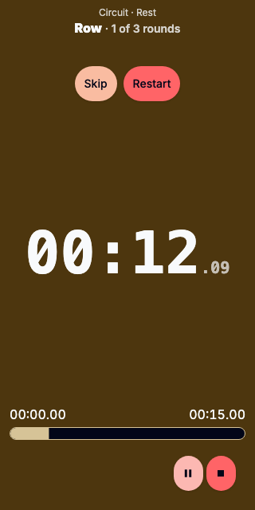

# Clock direction

Approved, implemented and verified.

## Setup

For Interval timers, including Interval phases in Complex timers, place an **Count up / Count down** choice immediately below each duration. Both default to **Count down**, including when opening an old preset. Work and Rest can be set independently. Hide the rest choice when rest is zero, as in EMOM. Keep its draft selection if the user restores a rest duration. Expose each pair as one labelled radio group with keyboard support, a visible selection mark and two 44 px touch targets.

## Playback

**Count up** starts at zero and ends at the set duration. **Count down** starts at the set duration and ends at zero. For 30 seconds of work and 15 seconds of rest, the example clock runs from zero to 30 during work and from 15 to zero during rest. Progress always fills from left to right as time passes. Choose direction during setup so the timer screen needs no extra controls.

## Acceptance after implementation

Save both choices with standalone presets and Complex phases. Verify old presets, reopening, pause/resume, skips, restarts, background catch-up and recovery. Use the current step duration and elapsed time for the display. Cues, transitions and completion use their existing deadlines. On completion, show the final duration for **Count up** or zero for **Count down**.

The screenshots are design mockups rendered against the current app at 320 × 640. The work preview uses the same digit, Skip button and footer bounds as the current timer at both portrait and [667 × 375 landscape](clock-direction/landscape.png).

## Implemented screens

[320 px setup](clock-direction/implemented-setup.png) · [Work counting up](clock-direction/implemented-work.png) · [Rest counting down](clock-direction/implemented-rest.png) · [Landscape](clock-direction/implemented-landscape.png)

Mobile Chromium tests covered independent selections, touch and keyboard input, hiding and restoring the rest choice, saved presets and Complex phases. Playback checks exercised both direction combinations through pause, resume, recovery, skip, completion and restart.
