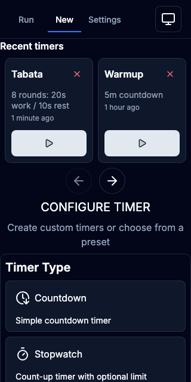
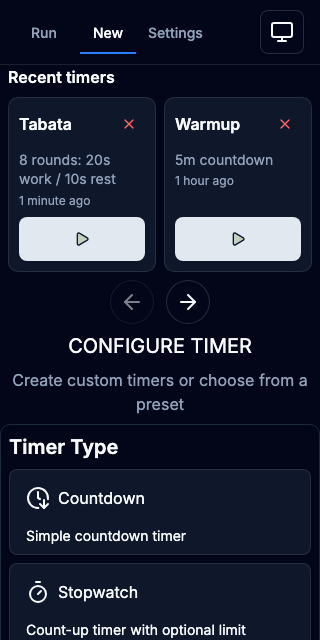

# Compact recent timers

Approved and implemented.

On New, show the two most recent timers side by side in the existing carousel on a portrait phone. Keep the newest first. Each card shows the timer name, its configuration summary and when it was last used. Show Start as a play icon with the accessible name “Start [timer name]”. Keep the existing full-width Start button at the bottom of each compact card, with the play icon centered. Keep Remove in the top-right corner beside the timer name. Use a small red X on a transparent background with a 44px touch target. Let text wrap to the available width.

Keep swipe and arrow navigation for older timers. With only one recent timer, use the available width. Show arrows only when there are more cards to reveal. Start opens the selected timer and Remove removes that entry. Preserve the existing empty state and desktop layout.

Verified in mobile Chromium at 320 × 640 with sample history. Two complete cards fit, both actions are at least 44 × 44px, and swiping works in both directions.

