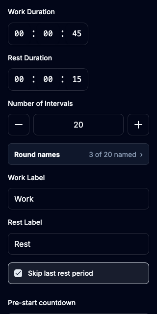
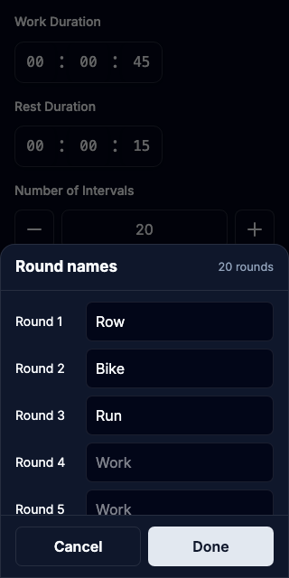
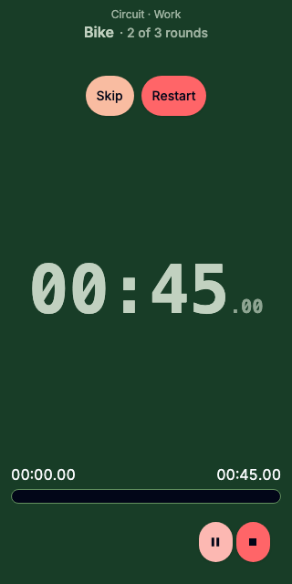

# Named intervals

**Status** — Approved, implemented and verified.

## Setup

Use one 44 px **Round names** row below **Number of Intervals** in Interval and EMOM settings, including Complex phases. Its trailing summary shows how many rounds have custom names. The setup form uses the same space at three rounds and at twenty.

Tap the row to open a bottom sheet. Scroll the numbered fields inside it. Keep **Cancel** and **Done** reachable above the phone keyboard. Done applies the names to the timer draft; Cancel discards edits from that visit. A blank field shows the configured work label as a placeholder. When the interval count changes, preserve names for surviving round numbers and omit out-of-range names when saving.

The touch preview reached and edited round 20, then updated the summary from three to four named rounds. See the implementation checks below for Safari keyboard behavior.

## During playback

The small timer and Work/Rest line stays in place. In the existing round-count line show the current round's name in bold, followed by its count. Keep the same name through work and rest, and update it when the round advances. For example, during the second rest the header reads “Circuit · Rest” above “Bike · 2 of 3 rounds.” An EMOM with zero rest moves directly to the next name.

Keep the count readable when a long name needs an ellipsis. Expose the full name to assistive technology. For a blank name or an older preset, use the existing work/rest label and round-count layout. Use the same round index after a skip, pause, restart, background catch-up or reload. Keep parent phase and repeat information in the Complex header.

## Preview and verification

In the expanded Complex timeline, label the round heading with its number and optional name. Keep Work and Rest on their individual timed steps. Store names with the Interval configuration and include them in preset identity.

These screenshots use temporary design changes in the current app at 320 × 640. In the illustrated running state, the clock, footer and Skip button had identical bounds before and after adding the name.

## Implemented screens

[Setup at 320 px](named-intervals/implemented-setup.png) · [Open editor](named-intervals/implemented-edit-20.png) · [Editing round 20](named-intervals/implemented-editor.png) · [Running timer](named-intervals/implemented-running.png) · [Landscape timer](named-intervals/implemented-running-landscape.png) · [iOS software keyboard](named-intervals/implemented-ios-keyboard.png)

The setup row measured 44 px high with both three and twenty rounds. Mobile Chromium and WebKit checks exercised scrolling, Cancel, Done, and round count changes. Saved presets and Complex phases reopened with the expected names. On iPhone 16 Pro Simulator, Safari kept the actions reachable while editing round 20 with the software keyboard open.

Running and paused timers retained the current name through work and rest. Browser tests covered skipping, restarting, recovery after reload, background catch-up, zero-rest EMOM transitions, and named rounds inside repeated Complex phases. The digit box and controls matched the unnamed layout at 320 × 640 and 667 × 375.
