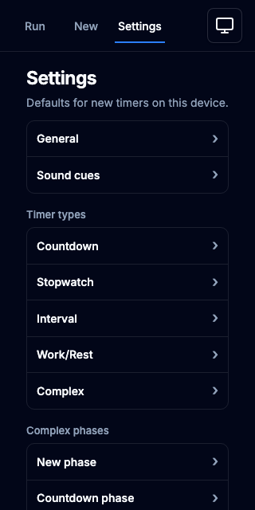
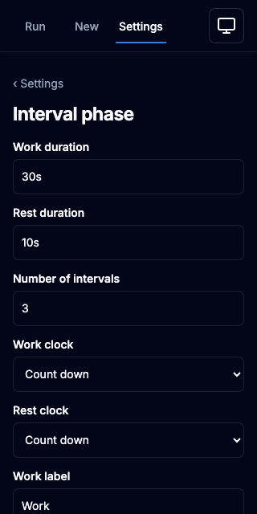
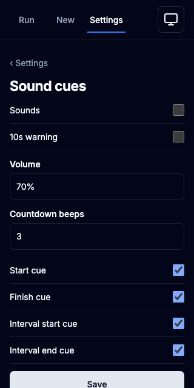

# Settings

Approved and implemented.

Add **Settings** as the third top tab, after **Run** and **New**. Keep the existing theme button on the right. Opening Settings shows a list of sections. Tapping a row opens just that editor, so a phone user can change one value without scrolling through every timer type. The running and paused timer screens keep their existing fullscreen layout.

## Defaults on first use

| Section | Starting values |
| --- | --- |
| General | Pre-start countdown **None**. Completion message **Time is up!** wherever that field is supported. |
| Sound cues | Sounds off, 10s warning off, volume 70%, three countdown beeps. Start, finish, interval start and interval end cues enabled when sound is on. |
| Countdown | Duration unset. |
| Stopwatch | No time limit. |
| Interval | Work duration, rest duration and interval count unset. Both clocks count down. Labels **Work** and **Rest**, round names empty, skip last rest on. |
| Work/Rest | Ratio-based rest at 1.0×. Fixed rest duration, work time limit and max rounds unset. Auto-continue off. |
| Complex | Empty phase list, auto-advance on, no overall time limit. A new repeat group starts at two repetitions. |

Timer names start on **Automatic** so editing the configuration still updates the generated name. In the Interval editor, use the existing compact editor for optional round names. Show fixed duration or ratio according to the chosen rest mode. Offer auto-continue for multiple rounds. Use the same time pickers, bounds and optional clearing behavior as New.

## Complex phases

A new phase starts as Countdown with an automatically generated name. Give each phase type its own settings because the app already uses different starting values inside a Complex timer.

| New phase | Starting values |
| --- | --- |
| Countdown | 1 minute |
| Stopwatch | No time limit |
| Interval | 3 rounds, 30s work, 10s rest. Both clocks count down, labels Work and Rest, skip last rest on. |
| Work/Rest | 5 rounds, 5m work limit, ratio-based rest at 2.0×, auto-continue off. |

The parent Complex timer controls sounds and pre-start. Duplicating a phase copies its current settings.

## Built-in presets

Each starter has its own entry. Changes apply on this device the next time that starter is used. All three currently have a 10s pre-start countdown.

| Starter | Starting values |
| --- | --- |
| Tabata | 8 rounds, 20s work, 10s rest, final rest skipped |
| EMOM (10 min) | 10 rounds, 1m work, 0s rest, final rest included |
| Work/Rest (1:1 ratio) | 20 rounds, 30m work limit, ratio-based rest at 1.0× |

## Saving and verification

**Save** stores the current section on this device. **Back** discards unsaved edits. New timers and newly added phases copy the applicable values when created. Saved presets, recent timers, interrupted timers and existing drafts retain their own values.

Verify each section after save and reload, editing a timer independently, discarding edits, and recovering from invalid or unwritable storage. Check keyboard access, 44px touch targets and horizontal fit at 320px. The images above are the approved design previews.

## Implemented screens

Captured from the running app at [320 × 640](personal-defaults/implemented-entry.png) and [640 × 320](personal-defaults/implemented-landscape.png). See the [Interval phase editor](personal-defaults/implemented-editor.png) and [sound cue settings](personal-defaults/implemented-sound-cues.png).
