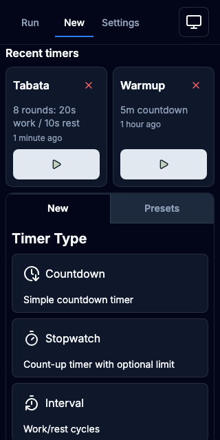
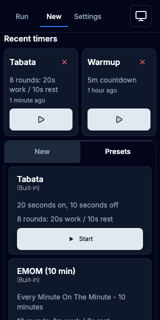

# New and Presets

Approved and implemented.

Replace the “Configure Timer” heading and its description with two tabs below Recent timers. The recent timer carousel stays directly below the app navigation in both views and keeps its position when switching tabs. On phones, swipe to browse older recents; omit the arrow row below the cards. Use one outer border around the tab headers and content. The selected tab shares its background with the content below and has an open bottom edge. Its top strip uses the same background color as the inactive tab. Open New by default to show the timer type picker. Presets contains the built-in and saved preset cards, with the existing actions to configure or start each timer.

Both tabs span the available width together and each has a 44px touch target. Use keyboard-accessible tabs. Returning from a preset editor should bring the user back to Presets. The same arrangement is shown in the [landscape preview](setup-tabs/implemented-landscape.png).

Verified at 320 × 640 in mobile Chromium. A left swipe revealed the third recent timer in New. Selecting Presets preserved the carousel position, and a right swipe returned to the first card.
