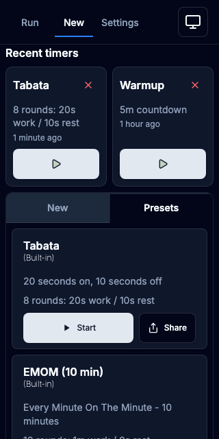
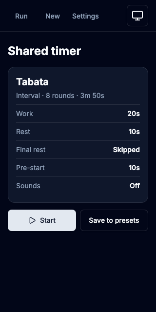

# Share a timer by link

Implemented from the approved mobile design. Screenshots show the running app.

## From Presets

Place Share beside Start on built-in and saved presets. Share uses the current preset configuration, including local changes to built-in starters. The phone's share sheet receives the URL. Where native sharing is unavailable, offer Copy link. Keep the card in place after sharing or cancelling.

## Opening the link

Show the timer name, type and settings before asking the recipient to act. For Interval, show rounds, work, rest, final-rest behavior, pre-start and sound status. The sample totals 3m 50s across eight work intervals and seven rests, with a separate 10s pre-start. For Complex, list phases in order and show repeat groups. Use the configured names and clock directions when present.

Start runs the shared settings, including pre-start. Save to presets stores a local copy and confirms the save. Preserve existing presets when names coincide. Opening the link alone does not start or save the timer.

## Link handling

The URL fragment carries a compressed, versioned timer definition. Bound the complete URL before sharing and the decoded size before import. Show “Timer too large to share by link” when necessary. An invalid or unsupported link opens an error state with a route back to New. The feature uses links exclusively.

Both views were verified at 320 × 640 with touch emulation. A fresh browser session can open the URL and start the timer or save a local copy. See also the [short landscape preview](share-link/open-landscape.png).
