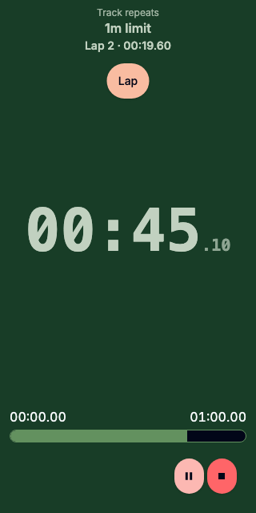
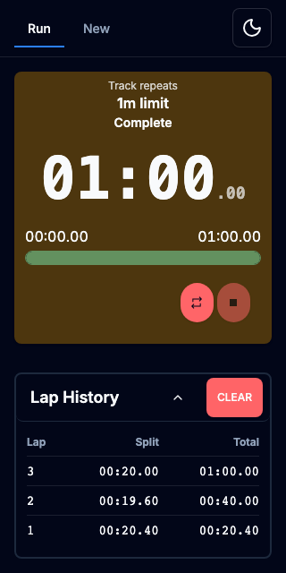

# Stopwatch splits

Approved, implemented and verified.

## During a run

Place **Lap** in the header, centered below the latest split in portrait, where the Interval controls appear. Match the Skip button’s 44 px height, minimum width, fill and rounded shape. In short landscape, center Lap in the same header row as the Interval actions. Reserve space around long header text and Complex phase information to prevent overlap. Each tap records the time since the previous mark (since Start for the first lap). Keep the main clock on total elapsed time. Use the existing status line to acknowledge the latest mark, for example **Lap 2 · 00:19.60**. Paused and Complete take priority in this line. Disable Lap during a pause and offer it only after the pre-start countdown. There is no setup option.

## After the run

Keep the existing collapsible history below the timer. When history contains at least two laps, show the fastest split and its lap number as **Best** (for example, **Lap 2 - 00:19:60**) in the collapsed summary and above the expanded table. In its expanded view, show **Lap**, **Split**, and **Total**, newest first. In this example the second split took 19.60 seconds and ended at 40.00 seconds. The one-minute limit closes the final 20.00-second split. Use the same rule at Stop, omit a zero-length tail, and record the final split only once. Start each run with a fresh baseline and distinguish runs if earlier laps remain in history.

## Checks before shipping

- Verify two marks across a pause, a manual stop, a time limit and a reload. Use the stopwatch's elapsed time at the tap, exclude paused time, and recover both earlier marks and the last mark's baseline.
- Check standalone and Complex Stopwatch phases, including the extra phase controls at 320 px. Keep touch targets reachable without overlap and give the Lap button keyboard and screen reader support.
- These are mockups rendered on the current standalone Stopwatch. At 320 × 640 the digits and footer retain their bounds. At [667 × 375](stopwatch-splits/landscape.png), Lap uses the centered Interval action row; the clock text box measures 101 px tall versus 119 px without the row. Pause and Stop retain their positions.

## Implementation checks

[320 px running timer](stopwatch-splits/implemented-running.png) · [Landscape timer](stopwatch-splits/implemented-landscape.png) · [Expanded split history](stopwatch-splits/implemented-history.png)

Mobile Chromium checks covered touch and keyboard marks, pause/resume, reload, manual Stop and automatic completion at the time limit. A restart began a separately labelled run. A stop at the exact time of the last mark produced no duplicate split. Complex Stopwatch checks covered pre-start, the centered header action and accessible phase navigation in both orientations.
