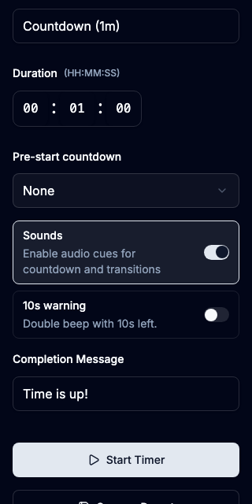

# 10s warning

The brighter descending [double beep](ten-second-warning/warning.wav) was preferred in the audio preview. Setup approved and implemented.

Show a **10s warning** switch directly below **Sounds** when sound is enabled and the timer has a timed period. Default it off for new and existing timers. Make the whole row tappable and expose its checked state to keyboard and screen reader users.

Play the cue once as a period crosses ten seconds remaining, independently of clock direction. Keep the finish horn at completion. Exclude pre-start countdowns and periods starting at ten seconds or less. Pausing and resuming must not repeat a warning; restarting a period arms it again. Skipping or catching up from the background must not replay missed warnings. Use the configured Sounds volume and respect mute. No running-screen changes.

## Implemented setup

[320 px screen with the warning enabled](ten-second-warning/implemented-setup.png)

Mobile Chromium checks verified touch and keyboard selection, preset save and reload, and a single warning sample across pause and resume. A simulated background transition skipped the missed warning. Unit checks covered Countdown, capped Stopwatch and Work/Rest work, rest periods, skips, restart and mute. Audibility over music on a physical iPhone remains unverified.
